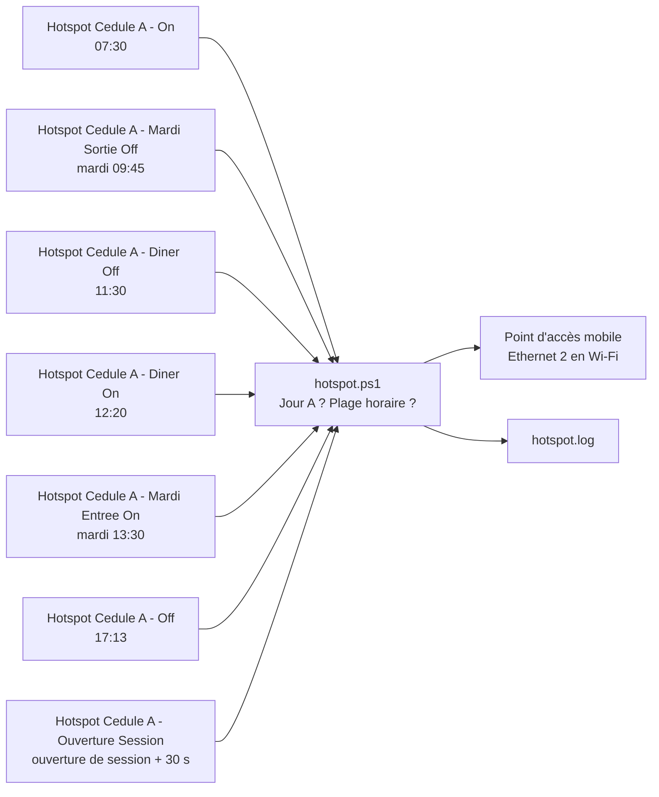

# Spec – Hotspot automatique (cédule A)

Version en ligne : https://claude.ai/artifact/Hvw3iuZpo92Cr4ZZDT3d1g · à jour au 2026-10-24

## Objectif

Partager automatiquement la connexion Ethernet du PC en Wi-Fi (point d'accès mobile Windows) pendant les heures de travail de la cédule A, sans intervention manuelle.

- **Dans la portée :** activation et arrêt automatiques du hotspot selon la cédule A, pause du dîner, journal des actions.
- **Hors portée :** autres cédules (B, etc.), jours fériés, gestion des appareils connectés, mot de passe du réseau.

## Contexte et prérequis

Le hotspot ne pouvait pas rester actif parce que le BIOS HP coupait la radio Wi-Fi dès que le câble Ethernet était branché. L'option a été désactivée le 2026-10-21.

| Élément | Valeur |
| --- | --- |
| Poste | HP ZBook Fury 15.6 G8 Mobile Workstation |
| Carte Wi-Fi | Intel Wi-Fi 6 AX201 (pilote 22.40.0.7) |
| Connexion partagée | Ethernet 2 (Intel I219-LM) |
| Nom du réseau (SSID) | WIN-R88L1LCIFQL 9783 |
| BIOS « LAN / WLAN Auto Switching » | Disable (était Enable) |
| Mise en veille et veille prolongée | Jamais, sur secteur et sur batterie |
| Fermeture du capot | Ne rien faire sur secteur, Veille sur batterie |

## Cédule A et horaire

La cédule A couvre 8 jours de suite (du mardi au mardi suivant), puis 6 jours sans partage, en cycle de 14 jours depuis le 2026-10-06, sans date de fin.

- Règle : jour du cycle = (date − 2026-10-06) en jours, modulo 14. Jours 0 à 7 = cédule A ; jours 8 à 13 = hors cédule.
- Premières périodes : 6 au 13 oct, 20 au 27 oct, 3 au 10 nov, 17 au 24 nov 2026.

| Heure | Action | Tâche planifiée |
| --- | --- | --- |
| 07:30 | Hotspot activé | Hotspot Cedule A - On |
| 11:30 | Coupé pour le dîner | Hotspot Cedule A - Diner Off |
| 12:20 | Réactivé | Hotspot Cedule A - Diner On |
| 17:13 | Coupé pour la journée | Hotspot Cedule A - Off |

Les deux mardis de la cédule ont leur propre plage. Le cycle commence un mardi, donc chaque mardi est soit le jour 0, soit le jour 7.

| Jour du cycle | Plage active | Tâche planifiée (le mardi seulement) |
| --- | --- | --- |
| 0, mardi d'entrée | 13:30 à 17:13 | Hotspot Cedule A - Mardi Entree On (13:30) |
| 1 à 6 | 07:30 à 17:13, sauf 11:30–12:20 | — |
| 7, mardi de sortie | 07:30 à 09:45 | Hotspot Cedule A - Mardi Sortie Off (09:45) |

À l'ouverture de la session Windows, la tâche « Hotspot Cedule A - Ouverture Session » lance l'action On 30 s plus tard. Le hotspot s'allume donc tout de suite si on est dans une plage active, au lieu d'attendre la prochaine heure prévue. Le déverrouillage (Windows + L) ne la déclenche pas.

## Architecture

Sept tâches planifiées Windows lancent le même script avec l'action On ou Off ; le script vérifie la cédule, puis pilote le hotspot.

- **Script :** `hotspot.ps1 -Action On|Off`, lancé en PowerShell masqué.
- **Tâches :** créées par `installer-taches.ps1` ; déclencheur quotidien (hebdomadaire le mardi pour les deux tâches du mardi, ouverture de session pour « Ouverture Session »), compte de l'utilisateur (session interactive, sans droits admin), rattrapage si l'heure a été manquée, fonctionne sur batterie, limite de 5 minutes.
- **API utilisée :** `NetworkOperatorTetheringManager` (partage de connexion) et `Windows.Devices.Radios` (radio Wi-Fi).

## Comportement détaillé

Le script ne touche jamais au hotspot hors cédule A, même si l'utilisateur l'a allumé lui-même.

**Plage active du jour :** de 07:30 (13:30 au jour 0) à 17:13 (09:45 au jour 7), sauf de 11:30 à 12:20 (dîner).

**Action On**

1. Hors cédule A : rien.
2. Hors de la plage active : rien.
3. Déjà actif : rien.
4. Sinon : allume la radio Wi-Fi si elle est éteinte, attend 3 s, puis démarre le partage de la connexion Internet active.

**Action Off**

1. Hors cédule A : rien.
2. Dans la plage active : rien. Un Off lancé à la main pendant la plage ne coupe donc pas le hotspot.
3. Déjà inactif : rien.
4. Sinon : arrête le partage.

**Rattrapage :** si le PC était éteint à l'heure prévue, la tâche s'exécute dès qu'il est disponible. Grâce à la plage active, une tâche rattrapée en retard ne démarre pas le hotspot hors plage et ne le coupe pas en pleine plage.

**Arrêt manuel :** le script ne garde aucun état entre deux exécutions. Si l'utilisateur coupe le hotspot lui-même (Paramètres Windows), il reste coupé jusqu'à la prochaine tâche On, qui le rallume normalement au début de la plage suivante (12:20 après le dîner, ou 07:30 le prochain jour A). Vérifié le 2026-10-22 : coupé par Windows à 12:25, rallumé par l'action On à 12:47.

**Cas limites**

- Aucune connexion Internet (câble débranché) : l'action échoue et le journal note « aucune connexion Internet disponible ».
- Une tâche est arrêtée si elle dépasse 5 minutes.

## Journal et dépannage

Chaque exécution ajoute une ligne à `hotspot.log` : date, heure, action (On/Off) et résultat.

| Message dans le journal | Signification | Quoi faire |
| --- | --- | --- |
| resultat : Success | Le hotspot a changé d'état | Rien |
| deja actif / deja inactif | Il était déjà dans le bon état | Rien |
| hors cedule A / hors plage horaire / dans la plage horaire | Le script n'avait rien à faire | Rien |
| aucune connexion Internet disponible | Pas de connexion à partager | Vérifier le câble Ethernet |
| resultat : WiFiDeviceOff | La radio Wi-Fi est coupée | Vérifier l'option BIOS et le mode avion |
| erreur : … | Erreur inattendue | Lancer la tâche à la main et lire le message |
| Aucune ligne à l'heure prévue | La tâche n'a pas tourné | Session fermée ou PC en veille : vérifier le Planificateur de tâches |

Test manuel : `Start-ScheduledTask -TaskName 'Hotspot Cedule A - On'`, puis lire la dernière ligne du journal.

## Limites et conditions

Les tâches ne tournent que si la session de l'utilisateur est ouverte et que le PC est allumé.

- **Session :** ouverte ou verrouillée (Windows + L), mais pas déconnectée. Après un redémarrage, il faut ouvrir la session.
- **Alimentation :** sur batterie, fermer le capot met le PC en veille et coupe le hotspot.
- **Réseau :** le câble Ethernet doit être branché ; le script partage la connexion Internet active.
- **Économie d'énergie du hotspot :** désactivée le 2026-10-22 (`PeerlessTimeoutEnabled = 0` sous `HKLM:\SYSTEM\CurrentControlSet\Services\icssvc\Settings`). Si elle est réactivée, Windows coupe le partage après 5 minutes sans appareil connecté (constaté le 2026-10-22 à 12:25).
- **Jours fériés et vacances :** non gérés ; le hotspot s'active quand même si c'est un jour A. (Question ouverte.)
- **Batterie :** la veille est désactivée aussi sur batterie, ce qui la vide plus vite.

## Validation

Les quatre tâches quotidiennes ont réussi le 2026-10-22 ; les deux tâches du mardi n'ont pas encore tourné.

| Test | Date | Résultat |
| --- | --- | --- |
| Tâche On relancée depuis le dossier du projet | 2026-10-22 | « deja actif », code 0 |
| Tâche On automatique à 07:30 | 2026-10-22 | Success, code 0 |
| Tâche On lancée à 07:08 (avant la plage) | 2026-10-22 | Rien fait, comme prévu |
| Vérification de la syntaxe du script après l'ajout du dîner | 2026-10-22 | Aucune erreur |
| Tâche « Ouverture Session » lancée à la main à 07:07 | 2026-10-24 | Code 0, « hors plage horaire » comme prévu |
| Simulation des mardis d'entrée et de sortie, d'un jour normal et de jours hors cédule (19 cas) | 2026-10-23 | Conforme |
| Calcul des jours A sur 30 jours | 2026-10-22 | 6–13 oct, 20–27 oct, 3 nov… conforme |
| Démarrage et arrêt manuels par l'API Windows | 2026-10-21 | Fonctionnent une fois l'option BIOS désactivée |

À vérifier :

- [x] Arrêt du dîner à 11:30 (Success, 2026-10-22)
- [x] Redémarrage à 12:20 (Success, 2026-10-22 ; coupé par Windows à 12:25, voir économie d'énergie)
- [x] Arrêt de fin de journée à 17:13 (Success, 2026-10-22)
- [ ] Le hotspot reste actif sans appareil connecté, depuis que l'économie d'énergie est désactivée
- [ ] Arrêt à 09:45 le 2026-10-27, premier mardi de sortie
- [ ] Aucune action le 2026-10-28, premier jour hors cédule
- [ ] Démarrage à 13:30 seulement le 2026-11-03, premier mardi d'entrée
- [ ] Démarrage automatique après une vraie ouverture de session pendant une plage active

## Maintenance

Pour changer un horaire, il faut modifier à la fois `installer-taches.ps1` et les heures en tête de `hotspot.ps1`, puis relancer `installer-taches.ps1`.

| Besoin | Comment |
| --- | --- |
| Changer une heure | Ajuster l'heure dans `installer-taches.ps1` et `$heureDebut`, `$heureFin`, `$dinerDebut`, `$dinerFin`, `$entreeDebut` ou `$sortieFin` dans `hotspot.ps1`, puis relancer `installer-taches.ps1` |
| Changer le cycle | Modifier `$debutCycle` (date de départ) et la règle `$jourCycle -le 7` dans `hotspot.ps1` |
| Suspendre (vacances) | `Get-ScheduledTask 'Hotspot Cedule A*' \| Disable-ScheduledTask` ; reprendre avec `Enable-ScheduledTask` |
| Tout supprimer | `.\desinstaller-taches.ps1`, puis supprimer le dossier `hotspot-cedule` |
| Rétablir l'option BIOS | PowerShell admin : `SetBIOSSetting` avec `Value='Enable'` pour « LAN / WLAN Auto Switching », puis redémarrer |
| Rétablir la veille | Paramètres → Système → Alimentation et mise en veille |
